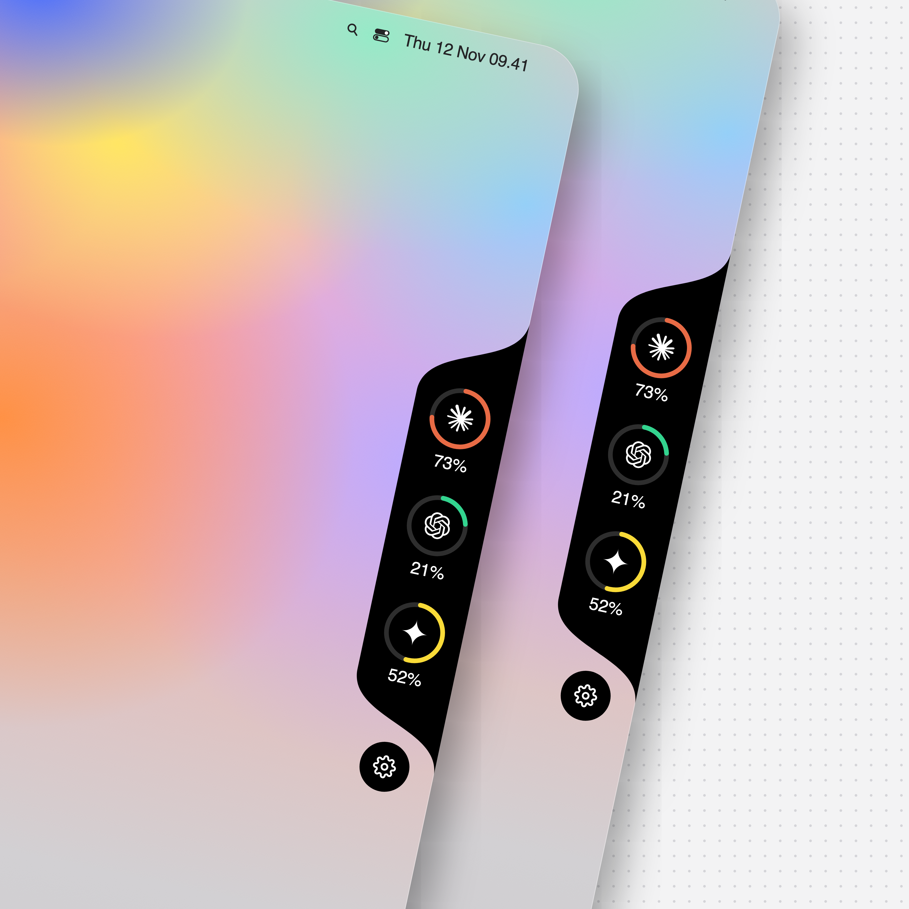

# Kota

Yapay zekâ aboneliklerinin kullanım limitlerini ekranın sağ kenarında gösteren küçük bir macOS widget'ı.



Her servis için bir halka vardır. Halka, o servisin sınıra en yakın penceresini (ör. 5 saatlik ya da haftalık) gösterir; üzerine gelince tüm pencereler ve sıfırlanma süreleri ipucunda görünür. Kullanım %90'ı geçince yüzde kırmızıya döner.

## Durum

| Servis | Veri kaynağı |
|---|---|
| Claude | `statusline.sh` (Claude Code durum satırı) |
| OpenAI (Codex) | henüz yok, halka "–" gösterir |
| Gemini | henüz yok, halka "–" gösterir |

## Kurulum

Gerekenler: macOS, Xcode komut satırı araçları (`swiftc`) ve `jq`.

```sh
git clone https://github.com/Voxyfy/kota.git
cd kota
./build.sh
open Kota.app
```

Uygulama Dock'ta ve Cmd+Tab'da görünmez. Kapatmak için widget'ın altındaki dişliden **Kota'dan Çık**'ı seç.

### Claude verisini bağlamak

`~/.claude/settings.json` dosyasına durum satırı betiğini ekle (yolu kendi klasörüne göre düzelt):

```json
{
  "statusLine": {
    "type": "command",
    "command": "/tam/yol/kota/statusline.sh"
  }
}
```

Betik çıktı vermez, yani Claude Code'un durum satırı boş kalır. Veri yalnızca Claude Code açıkken güncellenir.

## Ayarlar

Dişli menüsünden:

- servisleri tek tek gizleyip gösterebilir,
- boyutu seçebilirsin (Küçük, Orta, Büyük, Çok büyük).

## Başka bir servis eklemek

Uygulama yalnızca okur: 30 saniyede bir `~/.claude/kota/<id>.json` dosyalarına bakar. Bir servisin verisini göstermek için o dosyayı şu biçimde yazan bir betik yeterlidir:

```json
[
  {"label": "5 saatlik", "used_percentage": 33, "resets_at": 1794493200},
  {"label": "Haftalık", "used_percentage": 20, "resets_at": 1795021200}
]
```

`resets_at` epoch saniyedir. Sıfırlanma anı geçmiş bir pencerenin kullanımı 0 sayılır.

Yeni bir servis için ayrıca `main.swift` içindeki `providers` listesine bir satır ve `logos/<id>.svg` dosyası eklenir.
